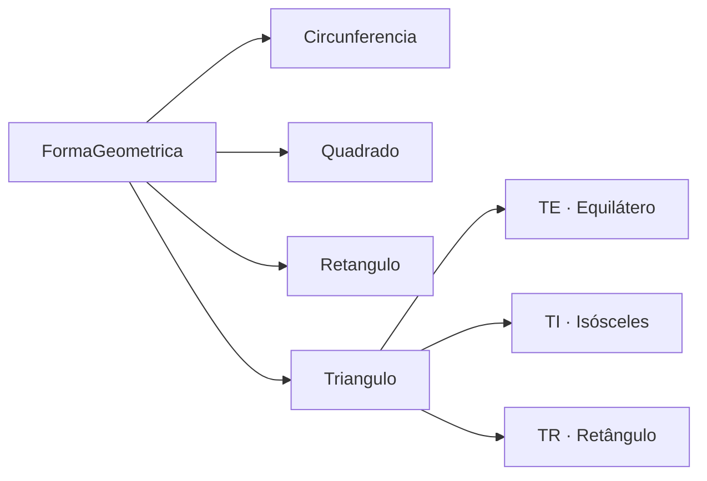

<p align="center">
  
</p>

<p align="center">Calculadora de áreas e perímetros com classes abstratas, herança e polimorfismo.</p>

<p align="center">
  
  
  
</p>

<p align="center"><a href="#visão-geral">Visão geral</a> &nbsp;·&nbsp; <a href="#recursos">Recursos</a> &nbsp;·&nbsp; <a href="#como-executar">Como executar</a></p>

---

## Visão geral

A aplicação permite selecionar diferentes figuras planas — circunferência, quadrado, retângulo e as três variações de triângulo (equilátero, isósceles e retângulo) — e calcula automaticamente área e perímetro a partir de uma hierarquia de classes coesa derivada de FormaGeometrica.

## Recursos

| Recurso | Como funciona |
|---|---|
| Classe base abstrata | FormaGeometrica define o contrato comum (CalcularArea e CalcularPerimetro) para todas as figuras. |
| Polimorfismo em triângulos | A classe Triangulo especializa-se em TE (Equilátero), TI (Isósceles) e TR (Retângulo), cada qual com sua fórmula exata. |
| Figuras circulares e quadriláteras | Classes dedicadas para Circunferencia, Quadrado e Retangulo encapsulam raio, lado, base e altura. |
| Interface dinâmica | O formulário Form1 habilita apenas os campos de entrada necessários para a figura geométrica selecionada. |
| Precisão matemática | Uso de Math.PI, Math.Pow e Math.Sqrt diretamente nas classes de domínio. |

## Tecnologias

- **C# e .NET Framework 4.7.2** para modelagem orientada a objetos e cálculos geométricos;
- **Windows Forms (WfaFormas)** para construção da janela nativa de interação no Windows;
- **MSBuild / Visual Studio Solution (SoFormas.sln)** para organização e compilação do projeto.

<details>
<summary>Arquitetura</summary>



O formulário Windows Forms instancia a subclasse correspondente à escolha do usuário, preenche suas propriedades geométricas e invoca os métodos polimórficos de cálculo sem precisar conhecer os detalhes algébricos de cada figura.

</details>

<details>
<summary>Estrutura do repositório</summary>

```text
AulaAps/
├── assets/
│   └── project-animal.png          Emblema do projeto
├── SoFormasAps/SoFormasAPS/
│   ├── SoFormas.sln                          Solução do Visual Studio
│   └── WfaFormas/
│       ├── FormaGeometrica.cs                Classe abstrata base
│       ├── Circunferencia.cs                 Cálculo com raio e Pi
│       ├── Quadrado.cs                       Cálculo por lado
│       ├── Retangulo.cs                      Cálculo por base e altura
│       ├── Triangulo.cs                      Base para triângulos
│       ├── TE.cs / TI.cs / TR.cs             Especializações de triângulo
│       └── Form1.cs                          Interface gráfica Windows Forms
└── README.md
```

</details>

## Como executar

1. Clone o repositório no Windows:
   ```powershell
   git clone https://github.com/arthurlynow098/AulaAps.git
   ```
2. Abra a solução SoFormasAps\SoFormasAPS\SoFormas.sln no **Visual Studio** (com workload de desenvolvimento para Desktop com .NET Framework 4.7.2).
3. Pressione **F5** (ou execute msbuild seguido de WfaFormas.exe) para abrir a interface e testar os cálculos geométricos.

## Decisões técnicas

- **Abstração de domínio:** separar cada forma em sua própria classe evita métodos gigantes com switch/case e permite adicionar novas figuras sem alterar as existentes (Princípio Aberto-Fechado).
- **Hierarquia em dois níveis para triângulos:** agrupar TE, TI e TR sob Triangulo reaproveita atributos comuns e especializa apenas o cálculo que muda entre eles.

---

<p align="center">
  <a href="https://github.com/arthurlynow098">GitHub</a> &nbsp;·&nbsp;
  <a href="https://arthurentsev.vercel.app/">Portfólio</a> &nbsp;·&nbsp;
  <a href="https://www.linkedin.com/in/entsevarthur/">LinkedIn</a>
</p>
